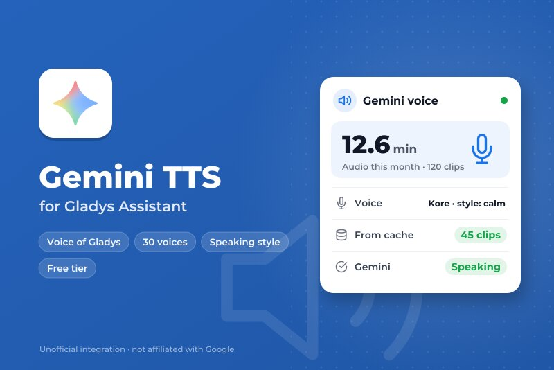
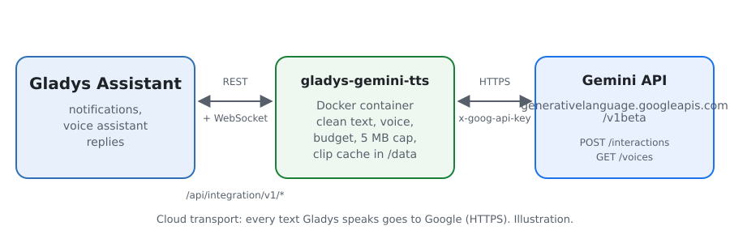
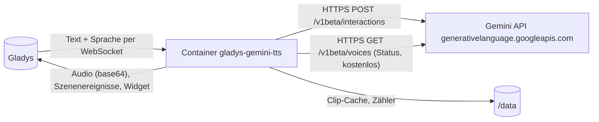
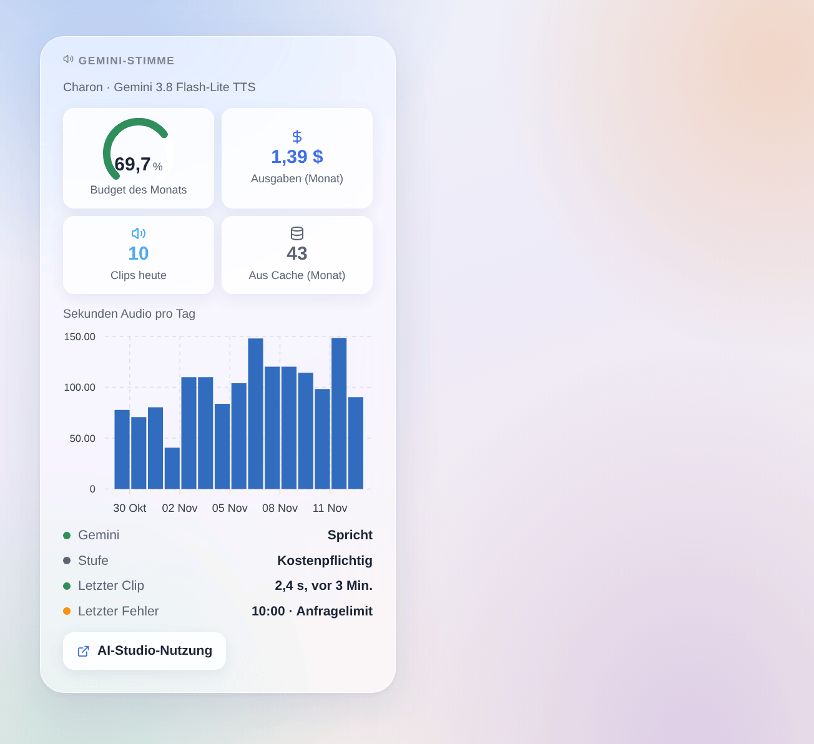

# Gladys Gemini TTS

[English](README.md) · [Français](README.fr.md) · **Deutsch** · [Español](README.es.md)

[](LICENSE)
[](https://github.com/William-De71/gladys-gemini-tts/releases)
[](https://github.com/William-De71/gladys-gemini-tts/actions/workflows/release.yml)
[](https://gladysassistant.com)



Externe Integration für [Gladys Assistant](https://gladysassistant.com), die Gladys eine **Gemini-Stimme** gibt — Modelle Gemini 3.8 Flash TTS, 30 Stimmen, eine Sprechweise — über die offizielle Gemini API und deinen eigenen API-Schlüssel aus Google AI Studio. Sobald sie unter Einstellungen → Künstliche Intelligenz als Stimme gewählt ist, spricht sie die Szenenbenachrichtigungen auf deinen Lautsprechern und die Antworten des Sprachassistenten, in der Sprache jedes Textes, kostenlos oder innerhalb eines Monatsbudgets.

Benutzerdokumentation: [English](docs/en.md) · [Français](docs/fr.md) · [Deutsch](docs/de.md) · [Español](docs/es.md).

Nicht mit Google verbunden. **Noch nicht mit einem echten Gemini-API-Schlüssel getestet**: Die Anfragen folgen der offiziellen API-Referenz (geprüft am 14. November 2026), und die Tests laufen gegen eine nachgebildete API. Rückmeldungen sind willkommen.

## Funktionen

- **TTS-Anbieter** (`type: "tts"`, Gladys 5.3+): Die Szenenaktion „Benachrichtigung abspielen“ und der Sprachassistent sprechen mit einer Gemini-Stimme.
- **Alle Sprachen, eine Stimme**: Gemini erkennt die Sprache jedes Textes; die 30 vordefinierten Stimmen (Kore, Charon, Puck…) sprechen sie alle. Eine Stimme der erweiterten Bibliothek oder eine in Google AI Studio entworfene Stimme (`voice_…`) kann sie ersetzen.
- **Sprechweise**: ein paar Wörter („calm and warm“), mit jedem Clip gesendet; die Stimm-Tags von Google (`<laugh>`, `<sigh>`, `<short pause>`…) bleiben in Szenentexten erhalten.
- **Kosten im Griff**: kostenlose Stufe, oder kostenpflichtige Stufe mit einem Monatsbudget, geschätzt aus den von Google gemeldeten Token und vor jedem Clip geprüft; ein Clip-Cache (300 Clips), damit ein bereits gesprochener Satz nie erneut angefragt wird; Markdown und Emoji werden vor dem Senden entfernt.
- **Passt zu Gladys**: WAV mit 24 oder 16 kHz; ein Clip über den 5 MB, die Gladys annimmt, wird auf 16 kHz gesenkt, statt zu scheitern.
- **Szenenauslöser**: Sprachausgabe schlägt fehl (Schlüssel abgelehnt, Guthaben aufgebraucht, Tageskontingent, Modell oder Stimme unbekannt, API nicht erreichbar), spricht wieder, und 80 % / 100 % des Monatsbudgets.
- **Dashboard-Widget**: Ausgaben oder Audio des Monats, Clips des Tages und aus dem Cache, Sekunden Audio pro Tag, Stufe, letzter Clip und letzter Fehler.
- Schaltflächen **Stimme testen**, **Stimmen auflisten** und **Clip-Cache leeren**. Englisch, Französisch, Deutsch und Spanisch.

## Funktionsweise





Eine Benachrichtigung, von der Szene bis zum Lautsprecher:

```mermaid
sequenceDiagram
  participant S as Szene
  participant G as Gladys
  participant I as Integration
  participant T as Gemini
  S->>G: Benachrichtigung abspielen „Das Garagentor ist offen“
  G->>I: synthesize(Text, "de")
  I->>I: Text bereinigen, Anfrage bauen (Modell, Stimme, Sprechweise)
  alt schon mit denselben Einstellungen gesprochen
    I->>I: Clip-Cache lesen (nichts angefragt)
  else neuer Satz, innerhalb des Budgets
    I->>T: POST interactions (TTS-Modell, Audio, store false)
    T-->>I: WAV 24 kHz (base64) + Token
    I->>I: Sekunden und Kosten zählen, Clip behalten
  end
  I-->>G: audio/wav;base64,…
  G->>G: Clip über eine einmalige lokale URL bereitstellen
  G->>S: der Lautsprecher spielt ihn
```

Gladys kürzt einen Text auf 2.000 Zeichen und wartet 30 s auf den Clip; die Integration gibt Gemini 26 s, wiederholt ein 429 pro Minute oder ein 5xx in dieser Zeit (nie ein Tageskontingent) und hält den Clip unter 5 MB. Ein Fehler wird nie verborgen: Die Szenenaktion schlägt sichtbar fehl, und der Sprachassistent antwortet schriftlich.

### Transport

`transports: ["cloud"]`: Alles geht per HTTPS an `generativelanguage.googleapis.com`, der Schlüssel im Header `x-goog-api-key`. **Google erhält jeden Text, den Gladys vorliest** (Benachrichtigungen, Antworten des Assistenten); die Anfragen gehen mit `store: false` raus. Auf der kostenlosen Stufe darf Google sie zur Verbesserung seiner Produkte nutzen. `/data` enthält die Zähler und den Clip-Cache (300 Clips, höchstens 40 MB); nichts anderes verlässt den Container.

## Modelle

| Modell                    | Kostenpflichtig, 10 s Sprache (2026 / ab 2027) | Sprachen     | Hinweise                     |
| ------------------------- | ---------------------------------------------- | ------------ | ---------------------------- |
| Gemini 3.8 Flash-Lite TTS | 0,0015 $ / 0,0030 $                            | mehr als 100 | Standard: schnell, günstiger |
| Gemini 3.8 Flash TTS      | 0,0023 $ / 0,0045 $                            | mehr als 130 | Am ausdrucksstärksten        |

Preise am 14. November 2026 auf ai.google.dev/gemini-api/docs/pricing geprüft: 0,50 $ pro Million gesendeter Text-Token, 6 $ (Flash-Lite) oder 9 $ (Flash) pro Million empfangener Audio-Token, 25 Audio-Token pro Sekunde Sprache, ab dem 1. Januar 2027 das Doppelte. Die kostenlose Stufe ist für beide kostenlos, mit einem Tageskontingent.

## Szenen und Widget



- **Auslöser „Gemini-Stimme: Sprachausgabe schlägt fehl“**: Variablen `kind` (`auth`, `disabled`, `billing`, `quota`, `rate_limit`, `model`, `voice`, `unreachable`, `timeout`, `server`), `message`, `voice`, `language`; Filter nach Art. Einmal pro Ausfall. Ein für sich abgelehnter Text (Sicherheitssperre) und das Monatsbudget lösen hier nichts aus.
- **Auslöser „Gemini-Stimme: spricht wieder“**: Variable `down_minutes`.
- **Auslöser „Gemini-Stimme: Monatsbudget“**: kostenpflichtige Stufe; Variablen `level` (`warning` bei 80 %, `reached` wenn ein Clip abgelehnt wird), `used` und `limit` (US-Dollar), `percent`, `month`; einmal pro Stufe und Abrechnungsmonat.
- **Widget „Gemini-Stimme“**: von der Integration gezählt; derselbe Schlüssel anderswo ist nicht enthalten. Google AI Studio bleibt die Referenz für die Rechnung.
- **Keine Szenenaktion**: Das Audio spielt Gladys selbst ab („Benachrichtigung abspielen“); ein Clip ist keine Ausgabe, die eine Szene nutzen könnte.

Beispiele:

- _Wenn die Sprachausgabe fehlschlägt_ (Art `quota`) → eine Telegram-Nachricht mit `{{triggerEvent.data.message}}` an den Administrator senden.
- _Wenn das Monatsbudget 80 % erreicht_ → eine E-Mail „Gemini-Stimme: `{{triggerEvent.data.percent}}` % des Budgets verbraucht“ senden.

## Voraussetzungen

- Gladys Assistant **5.3.0** oder neuer (TTS-Anbieter); ältere Instanzen können die Integration nicht installieren.
- Ein Gemini-API-Schlüssel aus [Google AI Studio](https://aistudio.google.com/apikey), in einem Land, in dem die Gemini API angeboten wird.

### Kosten und Limits

- **Kostenlose Stufe**: nichts zu zahlen, ein von Google pro Projekt festgelegtes Tageskontingent (siehe AI Studio); Google darf die Texte zur Verbesserung seiner Produkte nutzen.
- **Kostenpflichtige Stufe**: Abrechnung pro Token, pro Kalendermonat des Rechnungskontos (pazifische Zeit). Die Integration schätzt jeden Clip aus den von Google gemeldeten Token und stoppt beim **Monatsbudget** (standardmäßig 2 $). Sie zählt nur, was diese Integration sendet: Wird dasselbe Projekt anderswo genutzt, setze ein niedrigeres Budget oder ein Ausgabenlimit in Google AI Studio.
- **Vor einem Clip** auf der kostenpflichtigen Stufe werden seine Kosten aus dem Text geschätzt (12 Zeichen pro Sekunde Sprache, absichtlich etwas hoch), damit nie ein Clip startet, der das Budget überschreiten würde.

## Installation

- **Aus dem Store**: Integrationen → Gemini TTS → Installieren.
- **Über die URL des Repositorys**: Integrationen → externe Integration → `https://github.com/William-De71/gladys-gemini-tts`.
- **Entwicklermodus**: `npm start` mit den von Gladys gegebenen Variablen starten (siehe Entwicklung).

## Konfiguration

| Feld oder Schaltfläche | Standard                  | Bedeutung                                                               |
| ---------------------- | ------------------------- | ----------------------------------------------------------------------- |
| Gemini-API-Schlüssel   | —                         | Pflicht, ein Geheimnis: nie wieder angezeigt, nie protokolliert         |
| Modell                 | Gemini 3.8 Flash-Lite TTS | Siehe Modelle                                                           |
| Stimme                 | Kore                      | Eine der 30 vordefinierten Stimmen                                      |
| Andere Stimme          | —                         | Optional: eine Stimme der erweiterten Bibliothek oder eine `voice_…`-ID |
| Sprechweise            | —                         | Optional, ein paar Wörter auf Englisch, mit jedem Clip gesendet         |
| Audioqualität          | 24 kHz                    | WAV mit 24 oder 16 kHz                                                  |
| Stufe des Schlüssels   | Kostenlos                 | Kostenlos oder kostenpflichtig, wie in AI Studio angezeigt              |
| Monatsbudget           | 2 $                       | Nur kostenpflichtig; „Kein Budget“ lässt die Rechnung laufen            |
| Stimme testen          | —                         | Spricht einen kurzen Satz, zeigt Cliplänge und Monat an                 |
| Stimmen auflisten      | —                         | Deine Stimmen, dann die Katalogstimmen für eine Sprache (kostenlos)     |
| Clip-Cache leeren      | —                         | Vergisst die bereits gesprochenen Sätze                                 |

## Verwendung

1. In Gladys (Integrationen → Gemini TTS → Konfiguration): Füge den API-Schlüssel ein, wähle Modell, Stimme und auf Wunsch eine Sprechweise; drücke **Stimme testen**.
2. Einstellungen → **Künstliche Intelligenz**, Karte **Stimme**: Wähle **Gemini TTS**.
3. Nutze „Benachrichtigung abspielen“ in deinen Szenen; füge das Widget einem Dashboard hinzu; nutze die Auslöser.

## Entwicklung

```bash
npm install
npm test                       # node --test, eine nachgebildete Gemini API auf 127.0.0.1, nie das Netz
npm run lint                   # ESLint
npm run format:check           # Prettier
npx github:GladysAssistant/integration-store . --skip-image-check
scripts/build-cover.sh         # cover.jpg aus docs/assets/cover.svg
docs/illustrations/render.sh   # docs/assets/widgets.<lang>.png
```

Lokal liest das SDK `GLADYS_HOST_API_URL`, `GLADYS_INTEGRATION_TOKEN` und `GLADYS_INTEGRATION_SELECTOR` (von Gladys im Entwicklermodus gegeben), und die Integration liest `TZ`. `DEBUG=gladys-integration-sdk` zeigt die Protokolle des SDK.

Die Tests decken den HTTP-Client (beide Fehlerformen von Google, Fehlerarten, Wiederholungen, Fristen, maskierte Schlüssel), die WAV-Verarbeitung und den Rückfall auf 16 kHz, die Textbereinigung und die Stimm-Tags, den Clip-Cache, das Budget und seinen Abrechnungsmonat, die Auslöser, das Widget (`validateWidgetContent`), das Manifest, die vier Sprachen, das Release-Skript und die ganze Integration gegen das nachgebildete Gladys des SDK ab. `test/structure.test.js` friert jeden Schlüssel ein, den Nutzer speichern.

## Release-Prozess


Jedes Zusammenführen auf `main` startet die CI und berechnet dann die Version aus den [Conventional Commits](https://www.conventionalcommits.org/) seit dem letzten Tag: `feat` → Minor, `fix` / `perf` → Patch, `!` oder `BREAKING CHANGE` → Major (ein Minor unter 1.0.0); `docs`, `chore`, `ci`, `test`, `style`, `refactor`, `build` allein veröffentlichen nichts. Der Changelog-Abschnitt wird erzeugt, der Tag gepusht, das Multi-Architektur-Image gebaut, dann erhält `main` den Release-Commit, das GitHub Release wird erstellt und ein letzter Job prüft das öffentliche Image, den Store-Validator und das Topic.

- Der Titel des Pull Requests wird zum Squash-Commit, dann zur Changelog-Zeile: Schreib ihn auf Englisch, für den Nutzer (`pr-title.yml` prüft ihn). Bearbeite `CHANGELOG.md` nie von Hand.
- 1.0.0 ist eine Entscheidung: Actions → Release → Run workflow mit `release-as: 1.0.0`. `dry-run` zeigt Version und Notizen, ohne zu veröffentlichen.
- **Geschützter Branch**: Das Release pusht seinen Commit mit `GITHUB_TOKEN` auf `main`. Das Ruleset `protect-main` (kein Löschen, kein Force-Push) lässt ihn durch; eine strengere Regel (Pull Request Pflicht, Statusprüfungen) bräuchte GitHub Actions in ihrer Ausnahmeliste oder eine GitHub App.
- Mach nach dem ersten Release das Paket auf `ghcr.io` öffentlich (Package settings → Change visibility), sonst kann Gladys es nicht laden.

## Fehlerbehebung

Siehe [docs/de.md](docs/de.md#fehlerbehebung). Melde Probleme mit den Versionen von Gladys und der Integration, dem Modell, der Stimme, der Stufe, dem Lautsprecher und der Meldung von **Stimme testen**. Füge nie deinen API-Schlüssel ein.

## Mitwirken

Issues und Pull Requests sind willkommen, besonders von Leuten mit einem Gemini-API-Schlüssel: Eine fehlschlagende Anfrage (ohne den Schlüssel) hilft sehr. Führe `npm run format:check && npm run lint && npm test` aus, bevor du einen Pull Request öffnest, und lass jeden gespeicherten Schlüssel unverändert (siehe [CLAUDE.md](CLAUDE.md)).

## Sicherheit

Siehe [SECURITY.md](SECURITY.md): Melde Schwachstellen vertraulich. Der API-Schlüssel ist ein `secret`-Feld: nie protokolliert, nie in `/data` geschrieben, nur per HTTPS an `generativelanguage.googleapis.com` gesendet, in einem Header; ein in einer Fehlermeldung zitierter Schlüssel wird maskiert.

## Kommende Screenshots

Die Bilder oben sind Illustrationen, keine Screenshots. Echte Screenshots kommen in `docs/assets/screenshots/` (PNG, 1280 × 800): `configuration.png` (die Konfiguration mit ihrem Status und dem Ergebnis von Stimme testen), `ai-settings.png` (Gemini TTS in der Karte Stimme unter Einstellungen → Künstliche Intelligenz gewählt), `scene.png` (eine Szene „Benachrichtigung abspielen“).

## Lizenz

[Apache License 2.0](LICENSE) — siehe auch [NOTICE](NOTICE). Gemini, Google AI Studio und Google sind Marken von Google LLC; dieses Projekt ist nicht mit Google verbunden, wird nicht von Google unterstützt oder gesponsert. Danke an die Dokumentation und das SDK von Gladys sowie an die Dokumentation der Gemini API.
