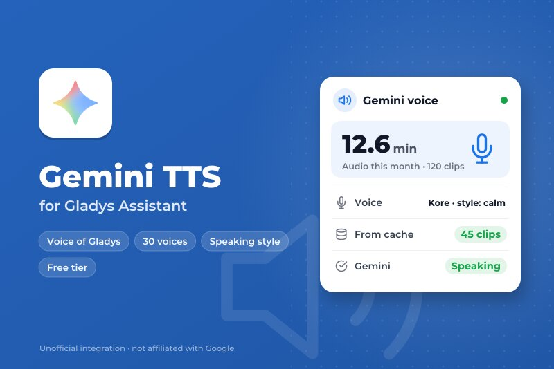
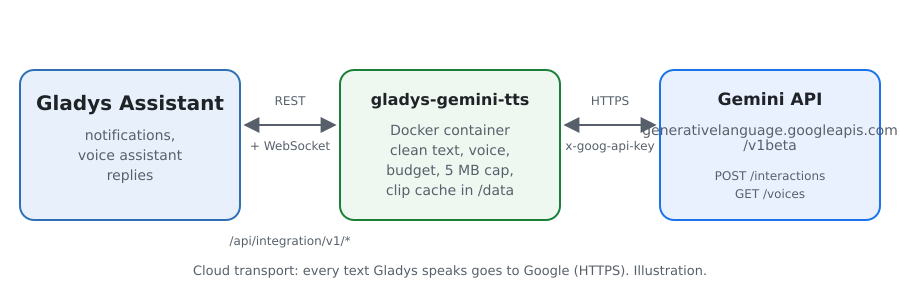
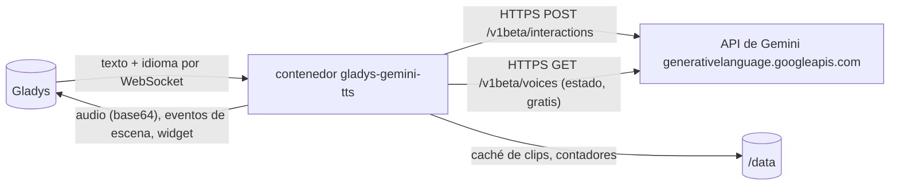
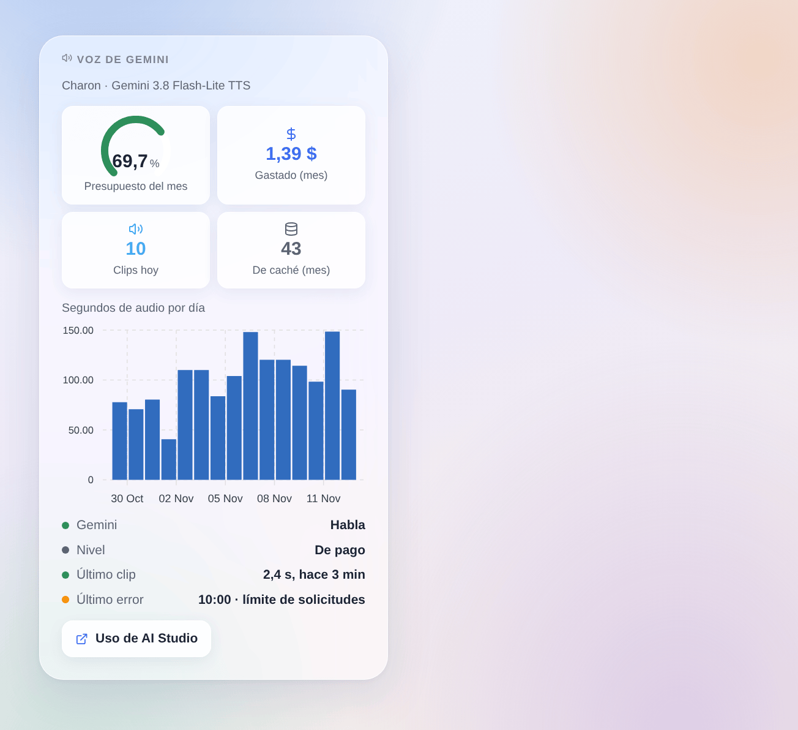

# Gladys Gemini TTS

[English](README.md) · [Français](README.fr.md) · [Deutsch](README.de.md) · **Español**

[](LICENSE)
[](https://github.com/William-De71/gladys-gemini-tts/releases)
[](https://github.com/William-De71/gladys-gemini-tts/actions/workflows/release.yml)
[](https://gladysassistant.com)



Integración externa para [Gladys Assistant](https://gladysassistant.com) que da a Gladys una **voz de Gemini** — modelos Gemini 3.8 Flash TTS, 30 voces, una forma de hablar — mediante la API oficial de Gemini y su propia clave de API de Google AI Studio. Una vez elegida como voz en Ajustes → Inteligencia artificial, pronuncia las notificaciones de las escenas en sus altavoces y las respuestas del asistente de voz, en el idioma de cada texto, en el nivel gratuito o dentro de un presupuesto mensual.

Documentación de usuario: [English](docs/en.md) · [Français](docs/fr.md) · [Deutsch](docs/de.md) · [Español](docs/es.md).

Sin afiliación con Google. **Todavía no probada con una clave de API de Gemini real**: las solicitudes siguen la referencia oficial de la API (comprobada el 14 de noviembre de 2026), y las pruebas se ejecutan contra una API simulada. Se agradecen los comentarios.

## Funciones

- **Proveedor TTS** (`type: "tts"`, Gladys 5.3+): la acción de escena «reproducir una notificación» y el asistente de voz hablan con una voz de Gemini.
- **Todos los idiomas, una sola voz**: Gemini reconoce el idioma de cada texto; las 30 voces predefinidas (Kore, Charon, Puck…) los hablan todos. Una voz de la biblioteca ampliada o una voz diseñada en Google AI Studio (`voice_…`) puede sustituirlas.
- **Forma de hablar**: unas palabras («calm and warm») enviadas con cada clip; las etiquetas vocales de Google (`<laugh>`, `<sigh>`, `<short pause>`…) se conservan en los textos de las escenas.
- **Costes bajo control**: nivel gratuito, o nivel de pago con un presupuesto mensual estimado a partir de los tokens que indica Google y comprobado antes de cada clip; una caché de clips (300 clips) para que una frase ya pronunciada no se vuelva a pedir nunca; Markdown y emoji eliminados antes del envío.
- **Adaptada a Gladys**: WAV a 24 o 16 kHz; un clip que supere los 5 MB que acepta Gladys se reduce a 16 kHz en lugar de fallar.
- **Disparadores de escena**: el habla falla (clave rechazada, crédito agotado, cuota diaria, modelo o voz desconocidos, API inaccesible), vuelve a hablar, y 80 % / 100 % del presupuesto mensual.
- **Widget de panel**: gasto o audio del mes, clips del día y de la caché, segundos de audio por día, nivel, último clip y último error.
- Botones **Probar la voz**, **Listar las voces** y **Vaciar la caché de clips**. Inglés, francés, alemán y español.

## Funcionamiento





Una notificación, de la escena al altavoz:

```mermaid
sequenceDiagram
  participant S as Escena
  participant G as Gladys
  participant I as Integración
  participant T as Gemini
  S->>G: reproducir una notificación «La puerta del garaje está abierta»
  G->>I: synthesize(texto, "es")
  I->>I: limpia el texto, construye la solicitud (modelo, voz, forma de hablar)
  alt ya pronunciada con los mismos ajustes
    I->>I: lee la caché de clips (nada pedido)
  else frase nueva, dentro del presupuesto
    I->>T: POST interactions (modelo TTS, audio, store false)
    T-->>I: WAV 24 kHz (base64) + tokens
    I->>I: cuenta segundos y coste, guarda el clip
  end
  I-->>G: audio/wav;base64,…
  G->>G: sirve el clip en una URL local de un solo uso
  G->>S: el altavoz lo reproduce
```

Gladys corta un texto a 2.000 caracteres y espera el clip 30 s; la integración da 26 s a Gemini, repite un 429 por minuto o un 5xx dentro de ese tiempo (nunca una cuota diaria) y mantiene el clip por debajo de 5 MB. Un fallo nunca se oculta: la acción de escena falla de forma visible, y el asistente de voz responde por escrito.

### Transporte

`transports: ["cloud"]`: todo va a `generativelanguage.googleapis.com` por HTTPS, la clave en la cabecera `x-goog-api-key`. **Google recibe cada texto que lee Gladys** (notificaciones, respuestas del asistente); las solicitudes se envían con `store: false`. En el nivel gratuito, Google puede usarlas para mejorar sus productos. `/data` guarda los contadores y la caché de clips (300 clips, 40 MB como máximo); nada más sale del contenedor.

## Modelos

| Modelo                    | Nivel de pago, 10 s de voz (2026 / desde 2027) | Idiomas    | Notas                           |
| ------------------------- | ---------------------------------------------- | ---------- | ------------------------------- |
| Gemini 3.8 Flash-Lite TTS | 0,0015 $ / 0,0030 $                            | más de 100 | Por defecto: rápido, más barato |
| Gemini 3.8 Flash TTS      | 0,0023 $ / 0,0045 $                            | más de 130 | El más expresivo                |

Precios comprobados en ai.google.dev/gemini-api/docs/pricing el 14 de noviembre de 2026: 0,50 $ por millón de tokens de texto enviados, 6 $ (Flash-Lite) o 9 $ (Flash) por millón de tokens de audio recibidos, 25 tokens de audio por segundo de voz, el doble a partir del 1 de enero de 2027. El nivel gratuito es gratis para ambos, con una cuota diaria.

## Escenas y widget



- **Disparador «Voz de Gemini: el habla falla»**: variables `kind` (`auth`, `disabled`, `billing`, `quota`, `rate_limit`, `model`, `voice`, `unreachable`, `timeout`, `server`), `message`, `voice`, `language`; filtro por tipo. Una vez por fallo. Un texto rechazado por sí solo (bloqueo de seguridad) y el presupuesto mensual no disparan nada aquí.
- **Disparador «Voz de Gemini: vuelve a hablar»**: variable `down_minutes`.
- **Disparador «Voz de Gemini: presupuesto del mes»**: nivel de pago; variables `level` (`warning` al 80 %, `reached` cuando se rechaza un clip), `used` y `limit` (dólares EE. UU.), `percent`, `month`; una vez por nivel y mes de facturación.
- **Widget «Voz de Gemini»**: contado por la integración; la misma clave usada en otro sitio no aparece. Google AI Studio sigue siendo la referencia para la factura.
- **Sin acción de escena**: el audio lo reproduce la propia Gladys («reproducir una notificación»); un clip no es una salida que una escena pueda usar.

Ejemplos:

- _Cuando el habla falla_ (tipo `quota`) → enviar un mensaje de Telegram al administrador con `{{triggerEvent.data.message}}`.
- _Cuando el presupuesto mensual llega al 80 %_ → enviar un correo «Voz de Gemini: `{{triggerEvent.data.percent}}` % del presupuesto usado».

## Requisitos

- Gladys Assistant **5.3.0** o posterior (proveedores TTS); las instancias más antiguas no pueden instalar la integración.
- Una clave de API de Gemini de [Google AI Studio](https://aistudio.google.com/apikey), en un país donde se ofrezca la API de Gemini.

### Costes y límites

- **Nivel gratuito**: nada que pagar, una cuota diaria fijada por Google para cada proyecto (ver AI Studio); Google puede usar los textos para mejorar sus productos.
- **Nivel de pago**: facturado por token, por mes natural de la cuenta de facturación (hora del Pacífico). La integración estima cada clip a partir de los tokens que indica Google y se detiene en el **presupuesto mensual** (2 $ por defecto). Solo cuenta lo que envía esta integración: si el mismo proyecto se usa en otro sitio, fije un presupuesto más bajo, o un límite de gasto en Google AI Studio.
- **Antes de un clip** en el nivel de pago, su coste se estima a partir del texto (12 caracteres por segundo de voz, a propósito un poco alto), para que nunca empiece un clip que superaría el presupuesto.

## Instalación

- **Desde la tienda**: Integraciones → Gemini TTS → Instalar.
- **Desde la URL del repositorio**: Integraciones → integración externa → `https://github.com/William-De71/gladys-gemini-tts`.
- **Modo desarrollador**: ejecute `npm start` con las variables que da Gladys (ver Desarrollo).

## Configuración

| Campo o botón            | Por defecto               | Significado                                                               |
| ------------------------ | ------------------------- | ------------------------------------------------------------------------- |
| Clave de API de Gemini   | —                         | Obligatoria, un secreto: no se vuelve a mostrar, nunca se registra        |
| Modelo                   | Gemini 3.8 Flash-Lite TTS | Ver Modelos                                                               |
| Voz                      | Kore                      | Una de las 30 voces predefinidas                                          |
| Otra voz                 | —                         | Opcional: una voz de la biblioteca ampliada, o un identificador `voice_…` |
| Forma de hablar          | —                         | Opcional, unas palabras en inglés, enviadas con cada clip                 |
| Calidad de audio         | 24 kHz                    | WAV a 24 o 16 kHz                                                         |
| Nivel de la clave        | Gratuito                  | Gratuito o de pago, como aparece en AI Studio                             |
| Presupuesto mensual      | 2 $                       | Solo nivel de pago; «Sin presupuesto» deja correr la factura              |
| Probar la voz            | —                         | Pronuncia una frase corta, muestra la duración del clip y el mes          |
| Listar las voces         | —                         | Sus voces, y luego las voces del catálogo para un idioma (gratis)         |
| Vaciar la caché de clips | —                         | Olvida las frases ya pronunciadas                                         |

## Uso

1. En Gladys (Integraciones → Gemini TTS → Configuración): pegue la clave de API, elija el modelo, la voz y, si lo desea, una forma de hablar; pulse **Probar la voz**.
2. Ajustes → **Inteligencia artificial**, tarjeta **Voz**: elija **Gemini TTS**.
3. Use «reproducir una notificación» en sus escenas; añada el widget a un panel; use los disparadores.

## Desarrollo

```bash
npm install
npm test                       # node --test, una API de Gemini simulada en 127.0.0.1, nunca la red
npm run lint                   # ESLint
npm run format:check           # Prettier
npx github:GladysAssistant/integration-store . --skip-image-check
scripts/build-cover.sh         # cover.jpg desde docs/assets/cover.svg
docs/illustrations/render.sh   # docs/assets/widgets.<lang>.png
```

En local, el SDK lee `GLADYS_HOST_API_URL`, `GLADYS_INTEGRATION_TOKEN` y `GLADYS_INTEGRATION_SELECTOR` (que da Gladys en modo desarrollador), y la integración lee `TZ`. `DEBUG=gladys-integration-sdk` muestra los registros del SDK.

Las pruebas cubren el cliente HTTP (las dos formas de error de Google, tipos de error, reintentos, plazos, claves enmascaradas), el tratamiento del WAV y el paso a 16 kHz, la limpieza del texto y las etiquetas vocales, la caché de clips, el presupuesto y su mes de facturación, los disparadores, el widget (`validateWidgetContent`), el manifiesto, los cuatro idiomas, el script de release, y toda la integración contra el Gladys simulado del SDK. `test/structure.test.js` congela cada clave que guardan los usuarios.

## Proceso de release


Cada fusión en `main` lanza la CI y luego calcula la versión a partir de los [Conventional Commits](https://www.conventionalcommits.org/) desde la última etiqueta: `feat` → menor, `fix` / `perf` → parche, `!` o `BREAKING CHANGE` → mayor (una menor antes de 1.0.0); `docs`, `chore`, `ci`, `test`, `style`, `refactor`, `build` solos no publican nada. Se genera la sección del changelog, se empuja la etiqueta, se construye la imagen multiarquitectura, luego `main` recibe el commit de release, se crea la GitHub Release y un último job comprueba la imagen pública, el validador de la tienda y el topic.

- El título de la pull request se convierte en el commit squash y luego en la línea del changelog: escríbalo en inglés, para el usuario (`pr-title.yml` lo comprueba). No edite nunca `CHANGELOG.md` a mano.
- La 1.0.0 es una decisión: Actions → Release → Run workflow con `release-as: 1.0.0`. `dry-run` muestra la versión y las notas sin publicar.
- **Rama protegida**: unos rulesets exigen una pull request en `main` y bloquean las etiquetas `v*`; solo pasan el mantenedor y las deploy keys. La publicación hace push con la deploy key del entorno `release` (secreto `RELEASE_DEPLOY_KEY`, solo `main`): una ejecución lanzada desde otra rama nunca la obtiene. `build.yml` y `github-release.yml` no arrancan con una etiqueta: la publicación los llama, o lánzelos a mano (Actions → Run workflow, con `version` para la imagen) para terminar una publicación.
- Tras la primera release, haga público el paquete de `ghcr.io` (Package settings → Change visibility), o Gladys no podrá descargarlo.

## Solución de problemas

Ver [docs/es.md](docs/es.md#solución-de-problemas). Informe de los problemas con las versiones de Gladys y de la integración, el modelo, la voz, el nivel, el altavoz y el mensaje de **Probar la voz**. No pegue nunca su clave de API.

## Contribuir

Las issues y pull requests son bienvenidas, sobre todo de personas con una clave de API de Gemini: una solicitud que falla (sin la clave) ayuda mucho. Ejecute `npm run format:check && npm run lint && npm test` antes de abrir una pull request, y mantenga sin cambios cada clave guardada (ver [CLAUDE.md](CLAUDE.md)).

## Seguridad

Ver [SECURITY.md](SECURITY.md): informe de las vulnerabilidades en privado. La clave de API es un campo `secret`: nunca se registra, nunca se escribe en `/data`, solo se envía a `generativelanguage.googleapis.com` por HTTPS, en una cabecera; una clave citada en un mensaje de error se enmascara.

## Capturas por venir

Las imágenes de arriba son ilustraciones, no capturas de pantalla. Las capturas reales irán en `docs/assets/screenshots/` (PNG, 1280 × 800): `configuration.png` (la configuración con su estado y el resultado de Probar la voz), `ai-settings.png` (Gemini TTS elegido en la tarjeta Voz de Ajustes → Inteligencia artificial), `scene.png` (una escena «reproducir una notificación»).

## Licencia

[Licencia Apache 2.0](LICENSE) — ver también [NOTICE](NOTICE). Gemini, Google AI Studio y Google son marcas de Google LLC; este proyecto no está afiliado, respaldado ni patrocinado por Google. Gracias a la documentación y al SDK de Gladys, y a la documentación de la API de Gemini.
