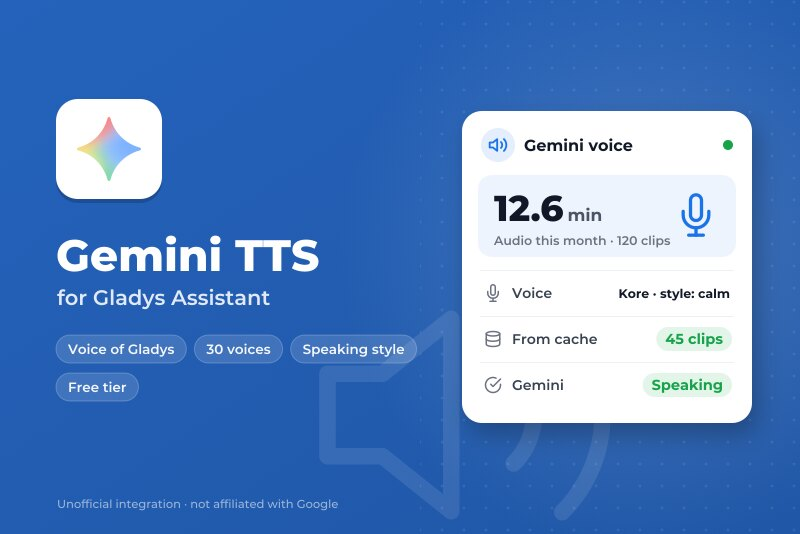
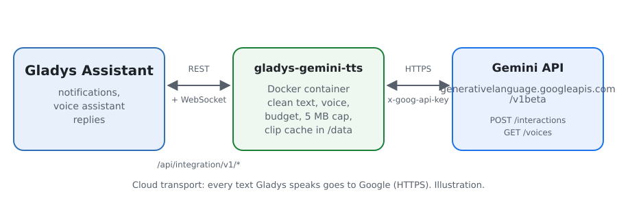
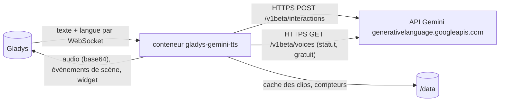
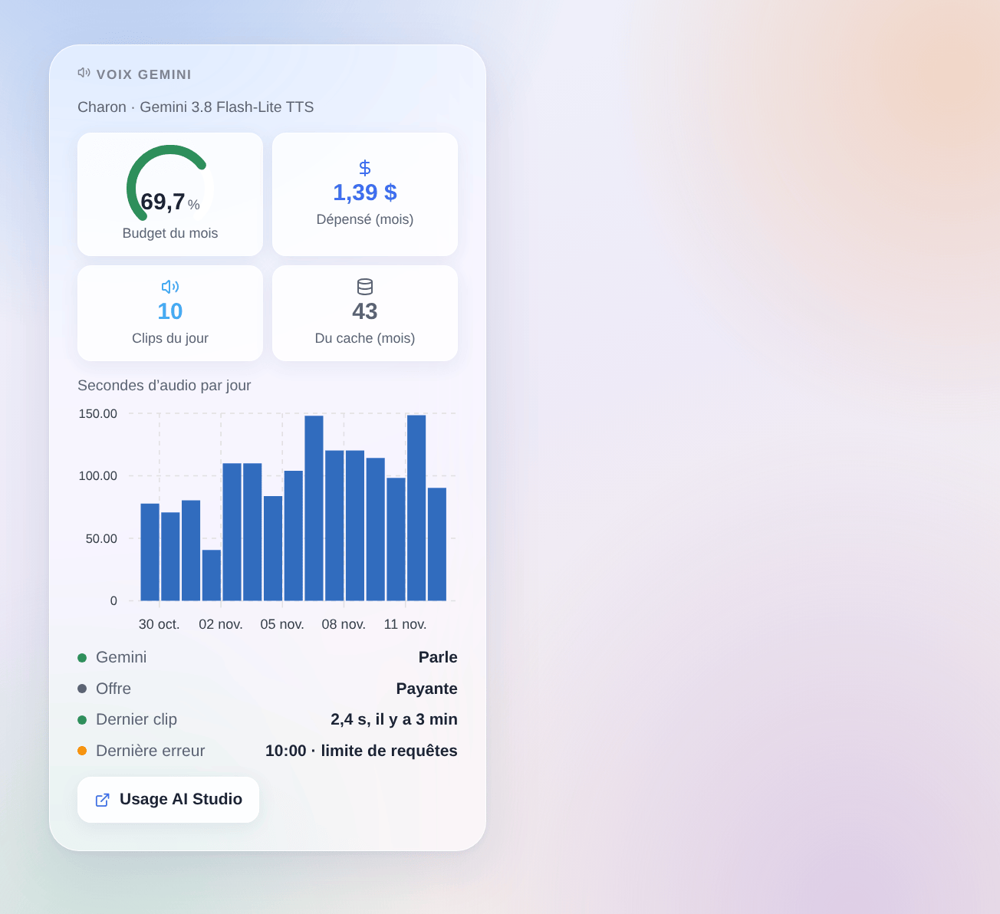

# Gladys Gemini TTS

[English](README.md) · **Français** · [Deutsch](README.de.md) · [Español](README.es.md)

[](LICENSE)
[](https://github.com/William-De71/gladys-gemini-tts/releases)
[](https://github.com/William-De71/gladys-gemini-tts/actions/workflows/release.yml)
[](https://gladysassistant.com)



Intégration externe pour [Gladys Assistant](https://gladysassistant.com) qui donne à Gladys une **voix Gemini** — modèles Gemini 3.8 Flash TTS, 30 voix, une façon de parler — via l’API Gemini officielle et votre propre clé d’API de Google AI Studio. Une fois choisie comme voix dans Paramètres → Intelligence artificielle, elle prononce les notifications des scènes sur vos enceintes et les réponses de l’assistant vocal, dans la langue de chaque texte, avec l’offre gratuite ou dans un budget mensuel.

Documentation utilisateur : [English](docs/en.md) · [Français](docs/fr.md) · [Deutsch](docs/de.md) · [Español](docs/es.md).

Non affiliée à Google. **Pas encore testée avec une vraie clé d’API Gemini** : les requêtes suivent la référence officielle de l’API (vérifiée le 14 novembre 2026), et les tests tournent contre une fausse API. Vos retours sont les bienvenus.

## Fonctionnalités

- **Fournisseur TTS** (`type: "tts"`, Gladys 5.3+) : l’action de scène « jouer une notification » et l’assistant vocal parlent avec une voix Gemini.
- **Toutes les langues, une seule voix** : Gemini reconnaît la langue de chaque texte ; les 30 voix prédéfinies (Kore, Charon, Puck…) les parlent toutes. Une voix de la bibliothèque étendue ou une voix conçue dans Google AI Studio (`voice_…`) peut les remplacer.
- **Façon de parler** : quelques mots (« calm and warm ») envoyés avec chaque clip ; les balises vocales de Google (`<laugh>`, `<sigh>`, `<short pause>`…) sont gardées dans les textes des scènes.
- **Coûts maîtrisés** : offre gratuite, ou offre payante avec un budget mensuel estimé d’après les jetons annoncés par Google et vérifié avant chaque clip ; un cache des clips (300 clips) pour qu’une phrase déjà prononcée ne soit jamais redemandée ; Markdown et emoji retirés avant l’envoi.
- **Adaptée à Gladys** : WAV à 24 ou 16 kHz ; un clip au-delà des 5 Mo acceptés par Gladys est ramené à 16 kHz au lieu d’échouer.
- **Déclencheurs de scène** : la parole échoue (clé refusée, crédit épuisé, quota du jour, modèle ou voix inconnus, API injoignable), parle de nouveau, et 80 % / 100 % du budget mensuel.
- **Widget de tableau de bord** : dépense ou audio du mois, clips du jour et du cache, secondes d’audio par jour, offre, dernier clip et dernière erreur.
- Boutons **Tester la voix**, **Lister les voix** et **Vider le cache des clips**. Anglais, français, allemand et espagnol.

## Fonctionnement





Une notification, de la scène à l’enceinte :

```mermaid
sequenceDiagram
  participant S as Scène
  participant G as Gladys
  participant I as Intégration
  participant T as Gemini
  S->>G: jouer une notification « La porte du garage est ouverte »
  G->>I: synthesize(texte, "fr")
  I->>I: nettoie le texte, construit la requête (modèle, voix, façon de parler)
  alt déjà prononcée avec les mêmes réglages
    I->>I: lit le cache des clips (rien demandé)
  else nouvelle phrase, dans le budget
    I->>T: POST interactions (modèle TTS, audio, store false)
    T-->>I: WAV 24 kHz (base64) + jetons
    I->>I: compte secondes et coût, garde le clip
  end
  I-->>G: audio/wav;base64,…
  G->>G: sert le clip sur une URL locale à usage unique
  G->>S: l’enceinte le joue
```

Gladys coupe un texte à 2 000 caractères et attend le clip 30 s ; l’intégration laisse 26 s à Gemini, relance un 429 par minute ou un 5xx dans ce délai (jamais un quota du jour), et garde le clip sous 5 Mo. Un échec n’est jamais caché : l’action de scène échoue visiblement, et l’assistant vocal répond par écrit.

### Transport

`transports: ["cloud"]` : tout part vers `generativelanguage.googleapis.com` en HTTPS, la clé dans l’en-tête `x-goog-api-key`. **Google reçoit chaque texte lu par Gladys** (notifications, réponses de l’assistant) ; les requêtes partent avec `store: false`. Sur l’offre gratuite, Google peut les utiliser pour améliorer ses produits. `/data` garde les compteurs et le cache des clips (300 clips, 40 Mo au plus) ; rien d’autre ne sort du conteneur.

## Modèles

| Modèle                    | Offre payante, 10 s de parole (2026 / dès 2027) | Langues     | Remarques                       |
| ------------------------- | ----------------------------------------------- | ----------- | ------------------------------- |
| Gemini 3.8 Flash-Lite TTS | 0,0015 $ / 0,0030 $                             | plus de 100 | Par défaut : rapide, moins cher |
| Gemini 3.8 Flash TTS      | 0,0023 $ / 0,0045 $                             | plus de 130 | Le plus expressif               |

Tarifs vérifiés sur ai.google.dev/gemini-api/docs/pricing le 14 novembre 2026 : 0,50 $ par million de jetons de texte envoyés, 6 $ (Flash-Lite) ou 9 $ (Flash) par million de jetons audio reçus, 25 jetons audio par seconde de parole, le double à partir du 1er janvier 2027. L’offre gratuite est gratuite pour les deux, avec un quota par jour.

## Scènes et widget



- **Déclencheur « Voix Gemini : la parole est en erreur »** : variables `kind` (`auth`, `disabled`, `billing`, `quota`, `rate_limit`, `model`, `voice`, `unreachable`, `timeout`, `server`), `message`, `voice`, `language` ; filtre par type. Une fois par panne. Un texte refusé à lui seul (blocage de sécurité) et le budget mensuel ne déclenchent rien ici.
- **Déclencheur « Voix Gemini : parle de nouveau »** : variable `down_minutes`.
- **Déclencheur « Voix Gemini : budget du mois »** : offre payante ; variables `level` (`warning` à 80 %, `reached` quand un clip est refusé), `used` et `limit` (dollars US), `percent`, `month` ; une fois par niveau et par mois de facturation.
- **Widget « Voix Gemini »** : compté par l’intégration ; la même clé utilisée ailleurs n’y figure pas. Google AI Studio reste la référence pour la facture.
- **Pas d’action de scène** : l’audio est joué par Gladys elle-même (« jouer une notification ») ; un clip n’est pas une sortie qu’une scène pourrait utiliser.

Exemples :

- _Quand la parole échoue_ (type `quota`) → envoyer un message Telegram à l’administrateur avec `{{triggerEvent.data.message}}`.
- _Quand le budget mensuel atteint 80 %_ → envoyer un e-mail « Voix Gemini : `{{triggerEvent.data.percent}}` % du budget utilisé ».

## Prérequis

- Gladys Assistant **5.3.0** ou plus récent (fournisseurs TTS) ; les instances plus anciennes ne peuvent pas installer l’intégration.
- Une clé d’API Gemini de [Google AI Studio](https://aistudio.google.com/apikey), dans un pays où l’API Gemini est proposée.

### Coûts et limites

- **Offre gratuite** : rien à payer, un quota par jour fixé par Google pour chaque projet (voir AI Studio) ; Google peut utiliser les textes pour améliorer ses produits.
- **Offre payante** : facturée au jeton, par mois civil du compte de facturation (heure du Pacifique). L’intégration estime chaque clip d’après les jetons annoncés par Google et s’arrête au **budget mensuel** (2 $ par défaut). Elle ne compte que ce que cette intégration envoie : si le même projet sert ailleurs, baissez le budget, ou fixez un plafond de dépense dans Google AI Studio.
- **Avant un clip** sur l’offre payante, son coût est estimé d’après le texte (12 caractères par seconde de parole, volontairement un peu haut), pour qu’un clip ne parte jamais s’il dépasserait le budget.

## Installation

- **Depuis le store** : Intégrations → Gemini TTS → Installer.
- **Depuis l’URL du dépôt** : Intégrations → intégration externe → `https://github.com/William-De71/gladys-gemini-tts`.
- **Mode développeur** : lancez `npm start` avec les variables données par Gladys (voir Développement).

## Configuration

| Champ ou bouton          | Par défaut                | Signification                                                                 |
| ------------------------ | ------------------------- | ----------------------------------------------------------------------------- |
| Clé d’API Gemini         | —                         | Obligatoire, un secret : jamais réaffichée, jamais journalisée                |
| Modèle                   | Gemini 3.8 Flash-Lite TTS | Voir Modèles                                                                  |
| Voix                     | Kore                      | L’une des 30 voix prédéfinies                                                 |
| Autre voix               | —                         | Facultatif : une voix de la bibliothèque étendue, ou un identifiant `voice_…` |
| Façon de parler          | —                         | Facultatif, quelques mots en anglais, envoyés avec chaque clip                |
| Qualité audio            | 24 kHz                    | WAV à 24 ou 16 kHz                                                            |
| Offre de la clé          | Gratuite                  | Gratuite ou payante, comme affiché dans AI Studio                             |
| Budget mensuel           | 2 $                       | Offre payante seulement ; « Pas de budget » laisse courir la facture          |
| Tester la voix           | —                         | Fait prononcer une courte phrase, affiche la durée du clip et le mois         |
| Lister les voix          | —                         | Vos voix, puis les voix du catalogue marquées pour une langue (gratuit)       |
| Vider le cache des clips | —                         | Oublie les phrases déjà prononcées                                            |

## Utilisation

1. Dans Gladys (Intégrations → Gemini TTS → Configuration) : collez la clé d’API, choisissez le modèle, la voix et, si vous le souhaitez, une façon de parler ; appuyez sur **Tester la voix**.
2. Paramètres → **Intelligence artificielle**, carte **Voix** : choisissez **Gemini TTS**.
3. Utilisez « jouer une notification » dans vos scènes ; ajoutez le widget à un tableau de bord ; utilisez les déclencheurs.

## Développement

```bash
npm install
npm test                       # node --test, une fausse API Gemini sur 127.0.0.1, jamais le réseau
npm run lint                   # ESLint
npm run format:check           # Prettier
npx github:GladysAssistant/integration-store . --skip-image-check
scripts/build-cover.sh         # cover.jpg depuis docs/assets/cover.svg
docs/illustrations/render.sh   # docs/assets/widgets.<lang>.png
```

En local, le SDK lit `GLADYS_HOST_API_URL`, `GLADYS_INTEGRATION_TOKEN` et `GLADYS_INTEGRATION_SELECTOR` (donnés par Gladys en mode développeur), et l’intégration lit `TZ`. `DEBUG=gladys-integration-sdk` affiche les journaux du SDK.

Les tests couvrent le client HTTP (les deux formes d’erreur de Google, types d’erreur, relances, délais, clés masquées), le traitement du WAV et le repli à 16 kHz, le nettoyage du texte et les balises vocales, le cache des clips, le budget et son mois de facturation, les déclencheurs, le widget (`validateWidgetContent`), le manifeste, les quatre langues, le script de release, et toute l’intégration contre le faux Gladys du SDK. `test/structure.test.js` fige chaque clé que les utilisateurs enregistrent.

## Processus de release


Chaque fusion sur `main` lance la CI, puis calcule la version à partir des [Conventional Commits](https://www.conventionalcommits.org/) depuis le dernier tag : `feat` → mineure, `fix` / `perf` → correctif, `!` ou `BREAKING CHANGE` → majeure (une mineure avant 1.0.0) ; `docs`, `chore`, `ci`, `test`, `style`, `refactor`, `build` seuls ne publient rien. La section du changelog est générée, le tag poussé, l’image multi-architecture construite, puis `main` reçoit le commit de release, la GitHub Release est créée et un dernier job vérifie l’image publique, le validateur du store et le topic.

- Le titre de la pull request devient le commit squash, puis la ligne du changelog : écrivez-le en anglais, pour l’utilisateur (`pr-title.yml` le vérifie). N’éditez jamais `CHANGELOG.md` à la main.
- La 1.0.0 est une décision : Actions → Release → Run workflow avec `release-as: 1.0.0`. `dry-run` montre la version et les notes sans publier.
- **Branche protégée** : la release pousse son commit sur `main` avec `GITHUB_TOKEN`. Le ruleset `protect-main` (ni suppression, ni force-push) le laisse passer ; une règle plus stricte (pull request obligatoire, vérifications) demanderait GitHub Actions dans sa liste de contournement, ou une GitHub App.
- Après la première release, rendez public le package `ghcr.io` (Package settings → Change visibility), sinon Gladys ne peut pas le télécharger.

## Dépannage

Voir [docs/fr.md](docs/fr.md#dépannage). Signalez les problèmes avec les versions de Gladys et de l’intégration, le modèle, la voix, l’offre, l’enceinte, et le message de **Tester la voix**. Ne collez jamais votre clé d’API.

## Contribuer

Les issues et pull requests sont les bienvenues, surtout de la part de personnes qui ont une clé d’API Gemini : une requête qui échoue (sans la clé) aide beaucoup. Lancez `npm run format:check && npm run lint && npm test` avant d’ouvrir une pull request, et gardez chaque clé enregistrée inchangée (voir [CLAUDE.md](CLAUDE.md)).

## Sécurité

Voir [SECURITY.md](SECURITY.md) : signalez les vulnérabilités en privé. La clé d’API est un champ `secret` : jamais journalisée, jamais écrite dans `/data`, envoyée seulement à `generativelanguage.googleapis.com` en HTTPS, dans un en-tête ; une clé citée dans un message d’erreur est masquée.

## Captures à venir

Les images ci-dessus sont des illustrations, pas des captures d’écran. Les vraies captures iront dans `docs/assets/screenshots/` (PNG, 1280 × 800) : `configuration.png` (la configuration avec son statut et le résultat de Tester la voix), `ai-settings.png` (Gemini TTS choisi dans la carte Voix de Paramètres → Intelligence artificielle), `scene.png` (une scène « jouer une notification »).

## Licence

[Licence Apache 2.0](LICENSE) — voir aussi [NOTICE](NOTICE). Gemini, Google AI Studio et Google sont des marques de Google LLC ; ce projet n’est ni affilié, ni approuvé, ni sponsorisé par Google. Merci à la documentation et au SDK de Gladys, et à la documentation de l’API Gemini.
