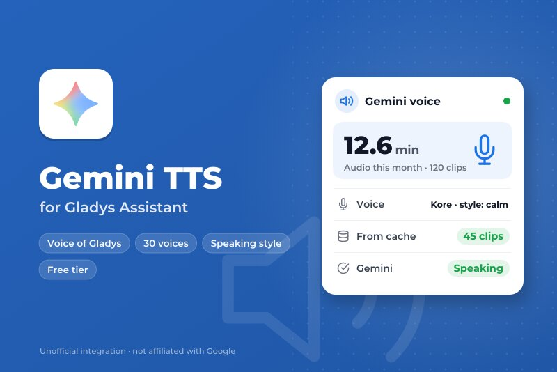
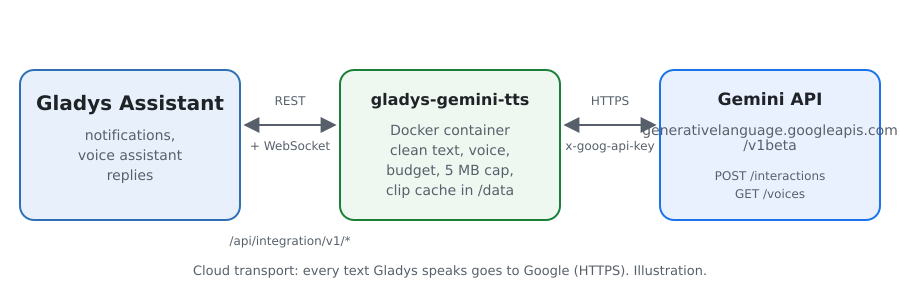
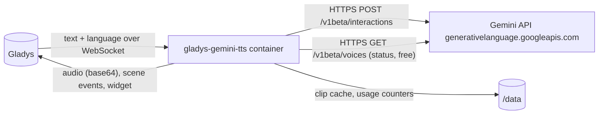
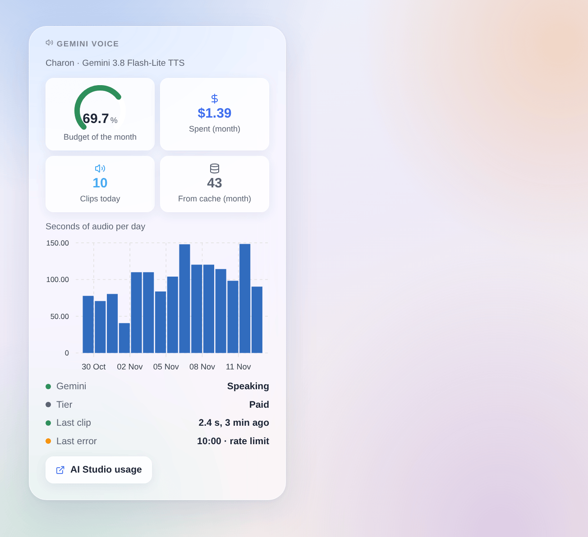

# Gladys Gemini TTS

**English** · [Français](README.fr.md) · [Deutsch](README.de.md) · [Español](README.es.md)

[](LICENSE)
[](https://github.com/William-De71/gladys-gemini-tts/releases)
[](https://github.com/William-De71/gladys-gemini-tts/actions/workflows/release.yml)
[](https://gladysassistant.com)



[Gladys Assistant](https://gladysassistant.com) external integration that gives Gladys a **Gemini voice** — Gemini 3.8 Flash TTS models, 30 voices, a speaking style — through the official Gemini API and your own API key from Google AI Studio. Once selected as the voice in Settings → Artificial Intelligence, it speaks the scene notifications on your speakers and the replies of the voice assistant, in the language of each text, on the free tier or within a monthly budget.

User documentation: [English](docs/en.md) · [Français](docs/fr.md) · [Deutsch](docs/de.md) · [Español](docs/es.md).

Not affiliated with Google. **Not tested with a real Gemini API key yet**: the requests follow the official API reference (checked on 14 November 2026), and the tests run against a fake API. Feedback welcome.

## Features

- **TTS provider** (`type: "tts"`, Gladys 5.3+): the "play a notification" scene action and the voice assistant speak with a Gemini voice.
- **Every language, one voice**: Gemini recognizes the language of each text; the 30 prebuilt voices (Kore, Charon, Puck…) speak them all. A voice of the Extended Voice Library or a voice designed in Google AI Studio (`voice_…`) can replace them.
- **Speaking style**: a few words ("calm and warm") sent with every clip; the vocal tags of Google (`<laugh>`, `<sigh>`, `<short pause>`…) are kept in scene texts.
- **Costs under control**: free tier, or paid tier with a monthly budget estimated from the tokens Google reports and checked before every clip; a clip cache (300 clips) so a sentence already spoken is never asked again; Markdown and emoji removed before sending.
- **Fits Gladys**: WAV at 24 or 16 kHz; a clip over the 5 MB Gladys accepts is brought down to 16 kHz instead of failing.
- **Scene triggers**: speech fails (key refused, credit used up, daily quota, model or voice unknown, API unreachable), speaks again, and 80 % / 100 % of the monthly budget.
- **Dashboard widget**: spending or audio of the month, clips of the day and from the cache, seconds of audio per day, tier, last clip and last error.
- **Test the voice**, **List the voices** and **Empty the clip cache** buttons. English, French, German and Spanish.

## How it works





A notification, from the scene to the speaker:

```mermaid
sequenceDiagram
  participant S as Scene
  participant G as Gladys
  participant I as Integration
  participant T as Gemini
  S->>G: play a notification "The garage door is open"
  G->>I: synthesize(text, "fr")
  I->>I: clean the text, build the request (model, voice, style)
  alt already spoken with the same settings
    I->>I: read the clip cache (nothing asked)
  else new sentence, within the budget
    I->>T: POST interactions (TTS model, audio out, store false)
    T-->>I: WAV 24 kHz (base64) + tokens
    I->>I: count seconds and cost, keep the clip
  end
  I-->>G: audio/wav;base64,…
  G->>G: serve the clip on a one-time LAN URL
  G->>S: the speaker plays it
```

Gladys cuts a text at 2,000 characters and waits 30 s for the clip; the integration gives Gemini 26 s, retries a 429 per minute or a 5xx within that time (never a daily quota), and keeps the clip under 5 MB. A failure is never hidden: the scene action fails visibly, and the voice assistant answers in text.

### Transport

`transports: ["cloud"]`: everything goes to `generativelanguage.googleapis.com` over HTTPS, the key in the `x-goog-api-key` header. **Google receives every text Gladys reads aloud** (notifications, replies of the assistant); requests are sent with `store: false`. On the free tier, Google may use them to improve its products. `/data` keeps the usage counters and the clip cache (300 clips, 40 MB at most); nothing else leaves the container.

## Models

| Model                     | Paid tier, 10 s of speech (2026 / from 2027) | Languages     | Notes                  |
| ------------------------- | -------------------------------------------- | ------------- | ---------------------- |
| Gemini 3.8 Flash-Lite TTS | $0.0015 / $0.0030                            | more than 100 | Default: fast, cheaper |
| Gemini 3.8 Flash TTS      | $0.0023 / $0.0045                            | more than 130 | The most expressive    |

Prices checked on ai.google.dev/gemini-api/docs/pricing on 14 November 2026: $0.50 per million text tokens in, $6 (Flash-Lite) or $9 (Flash) per million audio tokens out, 25 audio tokens per second of speech, double from 1 January 2027. The free tier is free for both, with a daily quota.

## Scenes and widget



- **Trigger "Gemini voice: speech fails"**: variables `kind` (`auth`, `disabled`, `billing`, `quota`, `rate_limit`, `model`, `voice`, `unreachable`, `timeout`, `server`), `message`, `voice`, `language`; filter by kind. Once per failure. A text refused on its own (a safety block) and the monthly budget start nothing here.
- **Trigger "Gemini voice: speaks again"**: variable `down_minutes`.
- **Trigger "Gemini voice: monthly budget"**: paid tier; variables `level` (`warning` at 80 %, `reached` when a clip is refused), `used` and `limit` (US dollars), `percent`, `month`; once per level and billing month.
- **Widget "Gemini voice"**: counted by the integration; the same key used elsewhere is not in it. Google AI Studio stays the reference for the bill.
- **No scene action**: the audio is played by Gladys itself ("play a notification"); a clip is not an output a scene could use.

Examples:

- _When speech fails_ (kind `quota`) → send a Telegram message to the administrator with `{{triggerEvent.data.message}}`.
- _When the monthly budget reaches 80 %_ → send an e-mail "Gemini voice: `{{triggerEvent.data.percent}}` % of the budget used".

## Requirements

- Gladys Assistant **5.3.0** or later (TTS providers); older instances cannot install the integration.
- A Gemini API key from [Google AI Studio](https://aistudio.google.com/apikey), in a country where the Gemini API is offered.

### Costs and limits

- **Free tier**: nothing to pay, a daily quota set by Google per project (see AI Studio); texts may be used by Google to improve its products.
- **Paid tier**: billed per token, per calendar month of the billing account (Pacific time). The integration estimates each clip from the tokens Google reports and stops at the **monthly budget** ($2 by default). It only counts what this integration sends: if the same project is used elsewhere, set a lower budget, or a spending cap in Google AI Studio.
- **Before a clip** on the paid tier, its cost is estimated from the text (12 characters a second of speech, on purpose a little high), so a clip never starts when it would go over the budget.

## Installation

- **From the store**: Integrations → Gemini TTS → Install.
- **From the repository URL**: Integrations → external integration → `https://github.com/William-De71/gladys-gemini-tts`.
- **Developer mode**: run `npm start` with the variables given by Gladys (see Development).

## Configuration

| Field or button      | Default                   | Meaning                                                             |
| -------------------- | ------------------------- | ------------------------------------------------------------------- |
| Gemini API key       | —                         | Required, a secret: never shown again, never logged                 |
| Model                | Gemini 3.8 Flash-Lite TTS | See Models                                                          |
| Voice                | Kore                      | One of the 30 prebuilt voices                                       |
| Other voice          | —                         | Optional: an Extended Voice Library voice, or a `voice_…` id        |
| Speaking style       | —                         | Optional, a few words in English, sent with every clip              |
| Audio quality        | 24 kHz                    | WAV at 24 or 16 kHz                                                 |
| Tier of the key      | Free                      | Free or paid, as shown in AI Studio                                 |
| Monthly budget       | $2                        | Paid tier only; "No budget" lets the bill run                       |
| Test the voice       | —                         | Speaks a short sentence, shows the length of the clip and the month |
| List the voices      | —                         | Your voices, then the catalog voices marked for a language (free)   |
| Empty the clip cache | —                         | Forgets the sentences already spoken                                |

## Usage

1. In Gladys (Integrations → Gemini TTS → Configuration): paste the API key, choose the model, the voice, a style if you like; press **Test the voice**.
2. Settings → **Artificial Intelligence**, **Voice** card: choose **Gemini TTS**.
3. Use "play a notification" in your scenes; add the widget to a dashboard; use the triggers.

## Development

```bash
npm install
npm test                       # node --test, a fake Gemini API on 127.0.0.1, never the network
npm run lint                   # ESLint
npm run format:check           # Prettier
npx github:GladysAssistant/integration-store . --skip-image-check
scripts/build-cover.sh         # cover.jpg from docs/assets/cover.svg
docs/illustrations/render.sh   # docs/assets/widgets.<lang>.png
```

Locally, the SDK reads `GLADYS_HOST_API_URL`, `GLADYS_INTEGRATION_TOKEN` and `GLADYS_INTEGRATION_SELECTOR` (given by Gladys in developer mode), and the integration reads `TZ`. `DEBUG=gladys-integration-sdk` shows the SDK logs.

The tests cover the HTTP client (both error shapes of Google, error kinds, retries, deadlines, masked keys), the WAV handling and the 16 kHz fallback, the text cleaning and the vocal tags, the clip cache, the budget and its billing month, the triggers, the widget (`validateWidgetContent`), the manifest, the four languages, the release script, and the whole integration against the fake Gladys of the SDK. `test/structure.test.js` freezes every key users store.

## Release process


Every merge on `main` runs the CI, then computes the version from the [Conventional Commits](https://www.conventionalcommits.org/) since the last tag: `feat` → minor, `fix` / `perf` → patch, `!` or `BREAKING CHANGE` → major (a minor below 1.0.0); `docs`, `chore`, `ci`, `test`, `style`, `refactor`, `build` alone publish nothing. The changelog section is generated, the tag pushed, the multi-architecture image built, then `main` receives the release commit, the GitHub Release is created and a last job checks the public image, the store validator and the topic.

- The pull request title becomes the squash commit, then the changelog line: write it in English, for the user (`pr-title.yml` checks it). Never edit `CHANGELOG.md` by hand.
- 1.0.0 is a decision: Actions → Release → Run workflow with `release-as: 1.0.0`. `dry-run` shows the version and the notes without publishing.
- **Protected branch**: the release pushes its commit to `main` with `GITHUB_TOKEN`. The `protect-main` ruleset (no deletion, no force-push) lets it through; a stricter rule (pull request required, status checks) would need GitHub Actions in its bypass list, or a GitHub App.
- After the first release, make the `ghcr.io` package public (Package settings → Change visibility), or Gladys cannot pull it.

## Troubleshooting

See [docs/en.md](docs/en.md#troubleshooting). Report issues with the versions of Gladys and of the integration, the model, the voice, the tier, the speaker, and the message of **Test the voice**. Never paste your API key.

## Contributing

Issues and pull requests are welcome, especially from people with a Gemini API key: a failing request (without the key) helps a lot. Run `npm run format:check && npm run lint && npm test` before opening a pull request, and keep every stored key unchanged (see [CLAUDE.md](CLAUDE.md)).

## Security

See [SECURITY.md](SECURITY.md): report vulnerabilities privately. The API key is a `secret` field: never logged, never written to `/data`, sent only to `generativelanguage.googleapis.com` over HTTPS, in a header; a key quoted in an error message is masked.

## Screenshots to come

The images above are illustrations, not screenshots. Real screenshots will go in `docs/assets/screenshots/` (PNG, 1280 × 800): `configuration.png` (the configuration with its status and the result of Test the voice), `ai-settings.png` (Gemini TTS chosen in the Voice card of Settings → Artificial Intelligence), `scene.png` (a "play a notification" scene).

## License

[Apache License 2.0](LICENSE) — see also [NOTICE](NOTICE). Gemini, Google AI Studio and Google are trademarks of Google LLC; this project is not affiliated with, endorsed or sponsored by Google. Thanks to the Gladys documentation and SDK, and to the Gemini API documentation.
