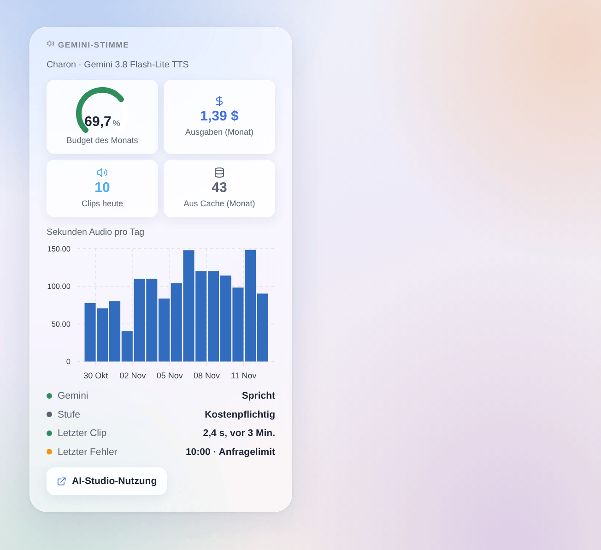

# Gemini TTS

## Überblick

Diese Integration gibt Gladys eine **Gemini-Stimme**, über die offizielle Gemini API und deinen eigenen API-Schlüssel aus Google AI Studio. Sobald du sie unter **Einstellungen → Künstliche Intelligenz** als Stimme wählst, läuft alles, was Gladys sagt, über Gemini: die Szenenaktion „Benachrichtigung abspielen“ auf deinen Lautsprechern und die gesprochenen Antworten des Sprachassistenten. Gemini erkennt die Sprache jedes Textes selbst, und jede Stimme spricht jede Sprache.

Du wählst unter 30 Stimmen (oder einer in Google AI Studio entworfenen Stimme) und kannst der Stimme eine Sprechweise geben („calm and warm“, „cheerful, speaking slowly“). Der Text einer Szene darf auch Stimm-Tags wie `<laugh>`, `<sigh>` oder `<short pause>` enthalten.

Die Kosten bleiben im Griff: Die kostenlose Stufe kostet nichts; auf der kostenpflichtigen Stufe stoppt ein Monatsbudget die Stimme, bevor es überschritten wird, und ein Clip-Cache sorgt dafür, dass ein bereits gesprochener Satz („Das Garagentor ist offen“) nie erneut angefragt wird. Dazu kommen drei Szenenauslöser (Sprachausgabe schlägt fehl, Sprachausgabe geht wieder, Monatsbudget) und ein Dashboard-Widget.

Nicht mit Google verbunden. Noch nicht mit einem echten Gemini-API-Schlüssel getestet: Rückmeldungen sind willkommen.

## Voraussetzungen

- Gladys Assistant 5.3.0 oder neuer.
- Ein **Gemini-API-Schlüssel**: Melde dich in [Google AI Studio](https://aistudio.google.com/apikey) mit einem Google-Konto an und klicke auf **Get API key**. Die Gemini API wird nicht in jedem Land angeboten.
- **Kostenlose Stufe**: nichts zu zahlen, eine von Google festgelegte Zahl von Anfragen pro Tag (in AI Studio angezeigt), und Google darf die empfangenen Texte zur Verbesserung seiner Produkte nutzen.
- **Kostenpflichtige Stufe** (Abrechnung oder Prepaid-Guthaben im Projekt des Schlüssels): Abrechnung pro Token, gesendeter Text und empfangenes Audio. Etwa 0,0015 $ pro 10 Sekunden Sprache mit Flash-Lite und 0,0023 $ mit Flash bis zum 31. Dezember 2026, ab dem 1. Januar 2027 das Doppelte. Ein Haushalt mit 50 Benachrichtigungen von 5 Sekunden pro Tag zahlt mit Flash-Lite etwa 1 $ im Monat.
- **Deine Daten**: Jeder Text, den Gladys vorliest (Benachrichtigungen, Antworten des Assistenten), geht per HTTPS an Google. Die Integration bittet Google, die Anfragen nicht zu speichern (`store: false`).

## Konfiguration

| Feld oder Schaltfläche | Standard                  | Bedeutung                                                                                            |
| ---------------------- | ------------------------- | ---------------------------------------------------------------------------------------------------- |
| Gemini-API-Schlüssel   | —                         | Pflicht. Wird nie wieder angezeigt, nie protokolliert                                                |
| Modell                 | Gemini 3.8 Flash-Lite TTS | Flash-Lite ist schnell und günstiger; Flash ist am ausdrucksstärksten                                |
| Stimme                 | Kore                      | Eine der 30 vordefinierten Stimmen, mit ihrem Charakter (bestimmt, warm, beschwingt…)                |
| Andere Stimme          | —                         | Optional: eine Stimme der erweiterten Bibliothek oder die ID einer in AI Studio entworfenen Stimme   |
| Sprechweise            | —                         | Optional, ein paar Wörter auf Englisch: „calm and warm“. Wird mit jedem Clip gesendet                |
| Audioqualität          | 24 kHz                    | WAV mit 24 oder 16 kHz; ein Clip über 5 MB (etwa 100 s bei 24 kHz) wird auf 16 kHz gesenkt           |
| Stufe des Schlüssels   | Kostenlos                 | Wie in AI Studio angezeigt; auf der kostenpflichtigen Stufe schätzt die Integration jeden Clip       |
| Monatsbudget           | 2 $                       | Nur kostenpflichtig: darüber werden Clips bis zum 1. des nächsten Monats abgelehnt (pazifische Zeit) |
| Stimme testen          | —                         | Spricht einen kurzen Satz (eine Anfrage des Kontingents) und zeigt Cliplänge und Monat an            |
| Stimmen auflisten      | —                         | Deine eigenen Stimmen, dann die Katalogstimmen für eine Sprache (kostenlos)                          |
| Clip-Cache leeren      | —                         | Vergisst die bereits gesprochenen Sätze                                                              |

Der Status des Konfigurationsbildschirms zeigt, ob Google den Schlüssel annimmt, ohne etwas zu erzeugen. Kontingent und verbleibendes Guthaben sieht er nicht: **Stimme testen** zeigt es.

## Verwendung

1. Integrationen → **Gemini TTS** → Konfiguration: Füge den API-Schlüssel ein, wähle Modell, Stimme und auf Wunsch eine Sprechweise; drücke **Stimme testen**.
2. Einstellungen → **Künstliche Intelligenz**, Karte **Stimme**: Wähle **Gemini TTS**.
3. Füge in einer Szene die Aktion **Benachrichtigung abspielen** auf einem Lautsprecher hinzu: Gladys spricht mit der Gemini-Stimme. Auch der Sprachassistent antwortet damit.

### Die Stimme wählen

| Modell                    | Kostenpflichtig, 10 s Sprache (2026 / ab 2027) | Einsatz                                                    |
| ------------------------- | ---------------------------------------------- | ---------------------------------------------------------- |
| Gemini 3.8 Flash-Lite TTS | 0,0015 $ / 0,0030 $                            | Alltägliche Benachrichtigungen, schnell, etwa 100 Sprachen |
| Gemini 3.8 Flash TTS      | 0,0023 $ / 0,0045 $                            | Die ausdrucksstärkste Stimme, mehr als 130 Sprachen        |

Preise am 14. November 2026 auf der Preisseite der Gemini API geprüft; die kostenlose Stufe ist für beide kostenlos. Hör dir die Stimmen in [Google AI Studio](https://aistudio.google.com/generate-speech) an, bevor du wählst. **Stimmen auflisten** zeigt die Stimmen der erweiterten Bibliothek für eine Sprache (eine Pariser Erzählerin, eine kanadische Stimme…): Gib eine davon oder die `voice_…`-ID einer in AI Studio entworfenen Stimme unter **Andere Stimme** ein.

Die Sprechweise gilt für jeden Clip: Halte sie kurz und auf Englisch, das gibt die besten Ergebnisse. Im Text einer Szene bleiben die Stimm-Tags von Google (`<laugh>`, `<sigh>`, `<whispers>`, `<short pause>`, `<long pause>`…) erhalten; jedes andere `<…>` und das Markdown der Assistentenantworten werden vor dem Senden entfernt.

### Dashboard-Widget

Das Widget **Gemini-Stimme** zeigt auf der kostenpflichtigen Stufe mit Budget die geschätzten Ausgaben des Monats im Vergleich dazu (Anzeige); dann die Ausgaben oder die Audiominuten des Monats, die Clips des Tages, die in diesem Monat aus dem Cache gelesenen Clips, die Sekunden Audio pro Tag über 30 Tage, ob Gemini spricht, die Stufe, den letzten Clip und den letzten Fehler. Es zählt, was diese Integration gesendet hat; derselbe Schlüssel anderswo ist nicht enthalten. Google AI Studio bleibt die Referenz für die Rechnung.

### Szenen

- **Auslöser „Gemini-Stimme: Sprachausgabe schlägt fehl“**: einmal pro Ausfall (Schlüssel abgelehnt, API nicht aktiviert, Abrechnung oder Guthaben, Tageskontingent, Anfragelimit, Modell unbekannt, Stimme unbekannt, API nicht erreichbar, zu langsam, Google-Fehler), mit Art, Meldung, Stimme und Sprache. Ein für sich abgelehnter Text (Sicherheitssperre, nichts zu sagen) und das Monatsbudget lösen hier nichts aus.
- **Auslöser „Gemini-Stimme: spricht wieder“**: der erste Clip nach einem Ausfall, mit den Minuten des Ausfalls.
- **Auslöser „Gemini-Stimme: Monatsbudget“**: auf der kostenpflichtigen Stufe bei 80 % des Budgets (`warning`), dann wenn ein Clip abgelehnt wird (`reached`), einmal pro Stufe und Monat, mit den ausgegebenen Dollar, dem Budget und dem Prozentsatz.

Beispiele: Wenn das Tageskontingent erreicht ist, eine Telegram-Nachricht an den Administrator senden; bei 80 % des Monatsbudgets eine E-Mail mit dem Prozentsatz senden; wenn das Budget erreicht ist, eine Textbenachrichtigung senden, die nichts kostet.

Es gibt keine Szenenaktion: Das Audio spielt Gladys selbst ab, über „Benachrichtigung abspielen“.

## Fehlerbehebung

- **„Google hat den API-Schlüssel abgelehnt“**: Kopiere den Schlüssel erneut aus Google AI Studio; prüfe seine Einschränkungen und ob die Gemini API in deinem Land angeboten wird.
- **„Tageskontingent der Gemini API erreicht“**: Die kostenlose Stufe erlaubt eine Zahl von Anfragen pro Tag; die Stimme kommt am nächsten Tag zurück. Wiederholte Sätze kommen aus dem Cache und verbrauchen keine Anfrage. Für mehr stelle das Projekt auf die kostenpflichtige Stufe um.
- **„Google lehnt wegen der Abrechnung ab“**: Das Prepaid-Guthaben ist aufgebraucht oder die Abrechnung nicht eingerichtet; lade Guthaben in Google AI Studio auf oder stelle **Stufe des Schlüssels** mit einem kostenlosen Schlüssel wieder auf kostenlos.
- **„Monatsbudget der Integration erreicht“**: Clips werden bis zum 1. des nächsten Monats (pazifische Zeit) abgelehnt; erhöhe das **Monatsbudget**, um weiterzumachen.
- **„Stimme abgelehnt“**: Die unter **Andere Stimme** eingegebene Stimme existiert nicht, oder ein `voicekey_…`-Schlüssel ist abgelaufen (7 Tage); drücke **Stimmen auflisten**.
- **„Google kennt das Modell nicht“**: Google hat es eingestellt; wähle das andere Modell.
- **Eine lange Antwort klingt dumpfer**: Sie überschritt die 5 MB, die Gladys annimmt, und wurde auf 16 kHz gesenkt. Nichts zu tun; für Sprache bleibt sie klar.
- **Ein Satz klingt jedes Mal anders**: Gemini-Stimmen variieren leicht von einer Erzeugung zur nächsten. Ein Satz im Cache behält seinen ersten Klang; drücke **Clip-Cache leeren**, um ihn neu zu hören.
- Protokolle: Einstellungen → Überwachung, die Protokolle der Integration. Teile niemals deinen API-Schlüssel.
